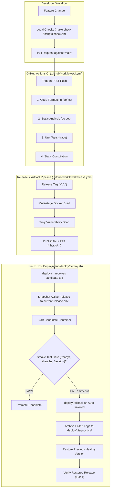

# PipeForge — CI/CD Automation & Deployment Reliability Lab

[](https://github.com/uday/pipeforge/actions/workflows/ci.yml)
[](https://github.com/uday/pipeforge/actions/workflows/release.yml)

**PipeForge** is a production-grade CI/CD and deployment reliability project designed to demonstrate core Systems Development Engineer (SDE) and Site Reliability Engineer (SRE) skills:
- **Go HTTP Services**: Standard-library HTTP microservice with structured JSON logging (`log/slog`), 12-factor configuration, and graceful connection draining.
- **Container Architecture**: Multi-stage, minimal `alpine:3.20` runtime (`~30MB`), running as an unprivileged non-root user (`UID 10001:10001`).
- **Continuous Integration**: GitHub Actions automated pipeline enforcing formatting (`gofmt`), static analysis (`go vet`), race detection (`go test -race`), and binary compilation.
- **Continuous Delivery**: Immutable semver tagging, digest tracking, and automated security vulnerability scanning with Trivy.
- **Deployment Reliability & Rollback**: Safe deployment state machine with bounded polling gates, failure log archiving, and automated rollback to the last known-good release.

---

## Architecture & Deployment Flow



---

## Verification Matrix

| Component / Requirement | Implementation | Local Verification | Linux Host (WSL2 Ubuntu) | CI/CD Configured |
| :--- | :--- | :--- | :--- | :--- |
| **Go HTTP Service** | `cmd/pipeforge-service/main.go` | PASS (7 unit tests) | PASS (curl verified) | Ready |
| **Liveness & Readiness** | `/healthz`, `/readyz`, `/version` | PASS | PASS | Ready |
| **Graceful Shutdown** | `os.Interrupt`, `SIGTERM` trap | PASS | PASS | Ready |
| **Local CI Script** | `scripts/check.sh` | PASS | PASS (`-race` clean) | Ready |
| **Makefile** | `make check`, `make build` | PASS | PASS | Ready |
| **GitHub Actions CI** | `.github/workflows/ci.yml` | Verified syntax | Verified locally | Pinned actions |
| **Multi-Stage Docker** | `Dockerfile` | PASS | PASS (`~30MB` image) | Ready |
| **Non-Root User** | `nonroot:nonroot (UID 10001)` | PASS | PASS (`id` verified) | Ready |
| **Release & GHCR** | `.github/workflows/release.yml` | Ready | Ready | Least privilege |
| **Deployment Gate** | `deploy/deploy.sh` | Ready | PASS (1.0.0 promoted) | Ready |
| **Smoke Tests** | `deploy/smoke-test.sh` | Ready | PASS (10-retry bounded) | Ready |
| **Automated Rollback** | `deploy/rollback.sh` | Ready | PASS (auto-drill tested) | Ready |
| **Diagnostic Archiving** | `deploy/diagnostics/` | Ready | PASS (saved failure logs) | Ready |

---

## Quickstart Reference

### 1. Run Local Verification Checks
```bash
# Run formatting, static analysis, unit tests, and compilation
./scripts/check.sh
# Or using make:
make check
```

### 2. Build and Run Container Locally
```bash
# Build multi-stage container
docker build -t pipeforge-service:1.0.0 .

# Verify non-root execution
docker run --rm --entrypoint id pipeforge-service:1.0.0
# Output: uid=10001(nonroot) gid=10001(nonroot) groups=10001(nonroot)
```

### 3. Deploy and Verify a Release
```bash
# Deploy release 1.0.0 on port 8085
./deploy/deploy.sh pipeforge-service:1.0.0 1.0.0

# Query endpoints
curl http://127.0.0.1:8085/healthz
curl http://127.0.0.1:8085/readyz
curl http://127.0.0.1:8085/version
```

### 4. Execute Rollback Drill
```bash
# Deploy a broken candidate: deploy.sh will fail verification and automatically restore 1.0.0!
./deploy/deploy.sh pipeforge-service:1.0.1-broken 1.0.1
```

---

## Interview Defense Points

1. **Liveness vs Readiness Probe Distinction**:
   - `/healthz` tests process liveness; failing it instructs the orchestrator to restart the container.
   - `/readyz` tests traffic viability; failing it pauses routing without killing the instance, preventing cascading restart storms.
2. **Graceful Connection Draining**:
   - On `SIGTERM`, readiness flips to `unready` so load balancers stop forwarding new requests, while `server.Shutdown(ctx)` permits in-flight requests to complete cleanly within a 10s deadline.
3. **Defense Against Secret Leaks & Non-Root Containers**:
   - Multi-stage build discards the Go compiler, source tree, and git history from the runtime image.
   - The container runs as an unprivileged user (UID `10001`) preventing privilege escalation attacks on the host.
4. **Deterministic Rollback**:
   - Releases preserve previous active state in an atomic state file.
   - If bounded smoke test polling times out, the previous container is restored immediately, verified, and failed logs are preserved for root-cause analysis.