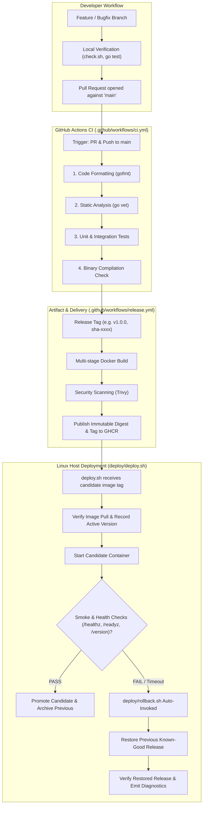

# PipeForge — Architecture and System Design

## 1. Overview

**PipeForge** is an automated, production-inspired deployment reliability pipeline for a containerized Go HTTP service. It is designed to demonstrate safe deployment mechanisms, automated validation, observability endpoints, and reliable rollback capabilities.

## 2. End-to-End Release & Deployment Flow

## 3. Core Architecture Components

### 3.1 HTTP Service (`cmd/pipeforge-service`)
- **Language**: Go standard library (minimal third-party dependencies).
- **Core Endpoints**:
  - `GET /healthz`: Liveness probe — returns `200 OK` if the process is alive.
  - `GET /readyz`: Readiness probe — returns `200 OK` when the service is ready to accept user traffic.
  - `GET /version`: Service metadata — outputs commit hash, build version, and runtime build date.
- **Reliability Features**:
  - Configurable server timeouts (Read, Write, Idle).
  - Clean signal handling (`SIGINT`, `SIGTERM`) with graceful connection draining.
  - Structured JSON logging with request tracing.

### 3.2 Container Architecture
- **Multi-Stage Build**: Separates heavy Go compilation tooling from the minimal runtime image.
- **Security Posture**: Runs as an unprivileged, non-root user (`nonroot:nonroot`).
- **Container Health Check**: Evaluates container health without installing heavyweight debugging tools inside the production image.

### 3.3 Deployment & Rollback Strategy
- **Orchestration**: Docker Compose on a Linux host.
- **Verification Gates**:
  1. Image validation before container startup.
  2. Startup grace period followed by bounded polling of `/readyz`.
  3. Release smoke test verifying HTTP status and release version.
- **Rollback Guarantee**: In-flight deployments preserve the last-known-good release identifier. If health checks fail or exceed timeout thresholds, the previous version is restored immediately, verified, and diagnostic logs are persisted.

