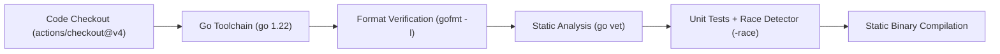
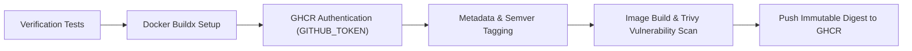

# PipeForge — CI/CD Pipeline & Security Posture

## 1. Overview

PipeForge implements a two-stage automated release pipeline:
1. **Continuous Integration (`.github/workflows/ci.yml`)**: Triggered on every pull request and push to `main`.
2. **Release & Publication (`.github/workflows/release.yml`)**: Triggered on semver tags (`v*.*.*`) or explicit manual dispatch.

## 2. Pipeline Workflows

### 2.1 Continuous Integration (`ci.yml`)

The CI workflow enforces strict quality and correctness gates before code can be merged into `main`:

- **Permissions**: `contents: read` (least privilege; cannot alter repository state or publish packages).
- **Failure Sensitivity**: Any non-zero exit code immediately terminates the job and blocks merge.

### 2.2 Release Pipeline (`release.yml`)

The release pipeline packages the verified service into an immutable OCI container image and publishes it to GitHub Container Registry (GHCR):

- **Authentication**: Uses ephemeral GitHub-provided `${{ secrets.GITHUB_TOKEN }}`. No long-lived Personal Access Tokens (PATs) are committed.
- **Traceability**: Each published image is tagged with its semantic version, short git commit SHA, and immutable content digest.
