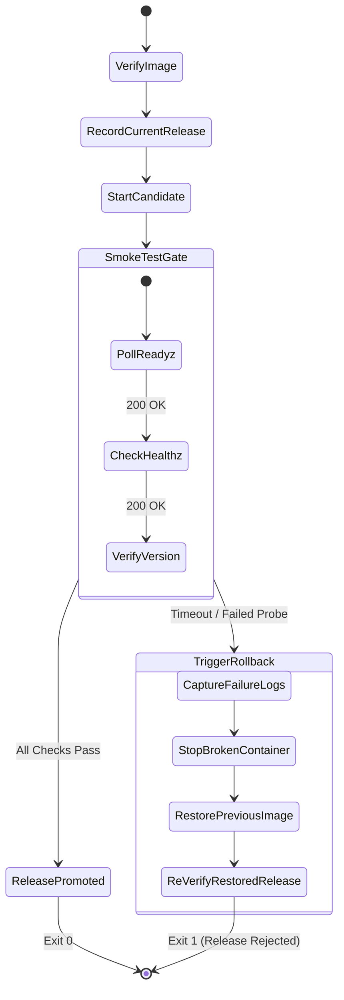

# PipeForge — Linux Deployment and Operational Reliability

## 1. Overview

Deployments in PipeForge prioritize **system availability** and **deterministic recovery**.
Instead of blind container recreation, deployment is treated as a state machine with a mandatory verification gate.

## 2. Deployment State Machine

## 3. Operational Guarantees

1. **Active Release Tracking**: Before any change occurs, the currently running release tag is snapshotted into `deploy/current-release.env`.
2. **Bounded Polling**: `smoke-test.sh` retries `/readyz` up to 10 times at 2-second intervals. It never loops indefinitely.
3. **Automated Rollback**: If the candidate fails any check, `rollback.sh` is immediately executed.
4. **Failure Preservation**: The broken container's logs are automatically saved to `deploy/diagnostics/failed_release_<timestamp>.log` before the container is destroyed, allowing engineers to conduct an immediate root-cause analysis.
