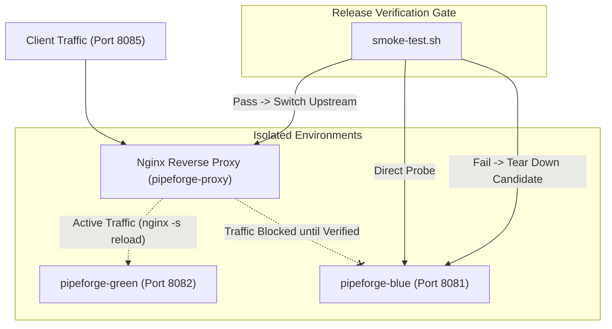

# PipeForge — Linux Deployment and Operational Reliability

## 1. Overview

Deployments in PipeForge prioritize **system availability** and **deterministic recovery**.
Instead of blind container recreation, deployment is treated as a state machine with a mandatory verification gate.

## 2. Zero-Downtime Blue/Green Architecture

## 3. Operational Guarantees

1. **True Zero Downtime**: Active traffic is served continuously by the current color while the candidate color is tested in isolation. Upstream traffic is switched instantly via `nginx -s reload`.
2. **Deterministic Rollback & Isolation**: A broken release candidate never receives user traffic. If verification fails, the candidate container is stopped immediately, preserving active traffic without dropping connections.
3. **Active Release Tracking**: Before any change occurs, the currently running release tag and color are snapshotted into `deploy/current-release.env`.
4. **Bounded Polling**: `smoke-test.sh` retries `/readyz` up to 10 times at 2-second intervals. It never loops indefinitely.
5. **Diagnostic Archiving**: Failed candidate logs are saved to `deploy/diagnostics/failed_candidate_<color>_<timestamp>.log` before container termination.
